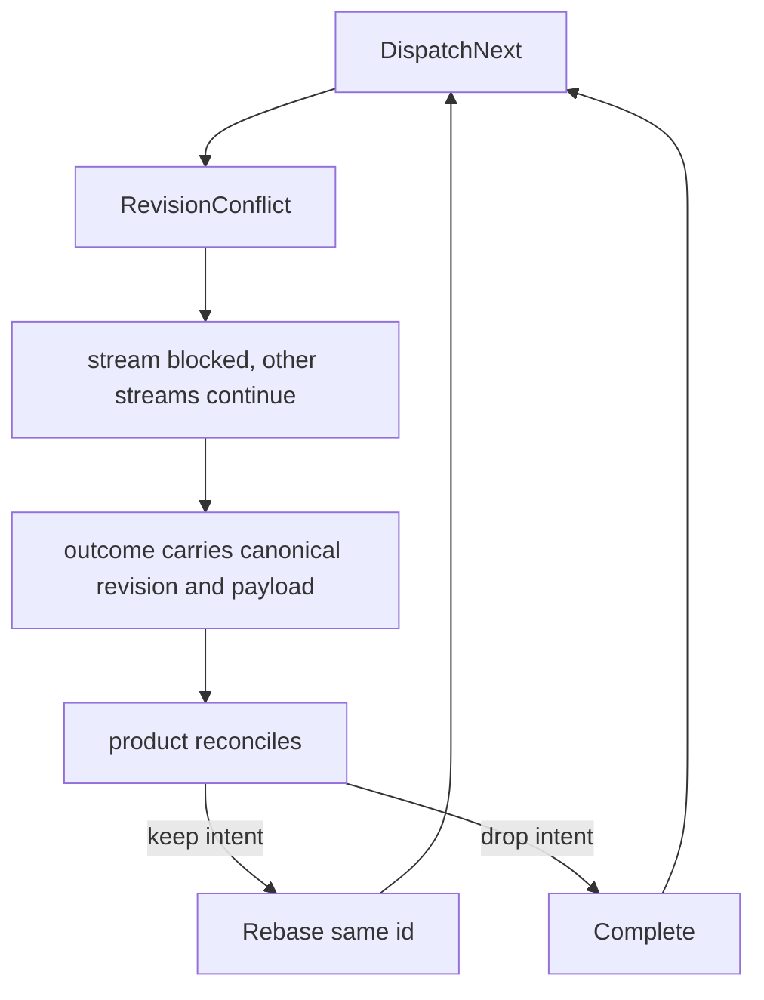

# Hung Sync (`com.hung.sync`)

Generic semantic synchronization overlay. Layer 1. Depends only on `com.hung.persistence`.

Sync is **not** a save backend. Local persistence answers "did state survive process death".
Sync answers "was this operation authenticated, ordered, accepted, rejected, retried, reconciled".

## Public API index

| Type | Purpose |
|---|---|
| `SyncOperation` | Operation envelope: stable id, stream key, expected revision, opaque payload |
| `SyncResult` | Server outcome plus canonical revision and payload |
| `SyncResultKind` | Accepted, DuplicateAccepted, RejectedBusinessRule, RevisionConflict, AuthenticationRequired, RetryableTransportFailure, PermanentProtocolFailure |
| `SyncAuthority` | OptimisticAllowed / ConfirmationRequired |
| `ISyncTransport` | Send one operation, get one result. Implemented outside this package |
| `ISyncAuthProvider` | Opaque auth token plus expiry signal. Never persisted |
| `ISyncClock` | Injectable UTC time. Keeps the package Unity-free and tests deterministic |
| `ISyncDiagnostics` | Payload-free structured diagnostics |
| `SyncRetryClassifier` | Pure mapping from transport outcome to `SyncResultKind` |
| `SyncQueue` | Durable pending queue persisted via `com.hung.persistence` |
| `SyncQueue.MarkConflicted` / `IsStreamBlocked` | Conflict blocks only its own stream (in memory) |
| `SyncQueue.Rebase` | Reconcile a conflicted operation in place: same id, new revision, optional new payload |
| `SyncEngine` | Dispatch, reconciliation, offline behavior |

## Conflicts

- The conflicted record never leaves the durable queue, so a crash during reconcile loses nothing.
- Later records on the same stream wait. If they are stale too, they conflict in turn and are rebased the same way.
- The blocked mark is not persisted. After a restart the record is sent once more, conflicts again and returns fresh canonical state.
- Reusing the operation id after `Rebase` is safe: the authority never applied the conflicted attempt.

## Hard rules

- Auth tokens are never logged and never stored in the queue.
- Payloads are stored in the queue (retries need them) but never logged or sent to diagnostics.
- Retries reuse the same operation id; a new business intent gets a new id.
- Queue uses `SaveFailurePolicy.FailClosed`.
- Conflicts never resolve by last-write-wins.
- No Unity API calls. No product/domain types.
